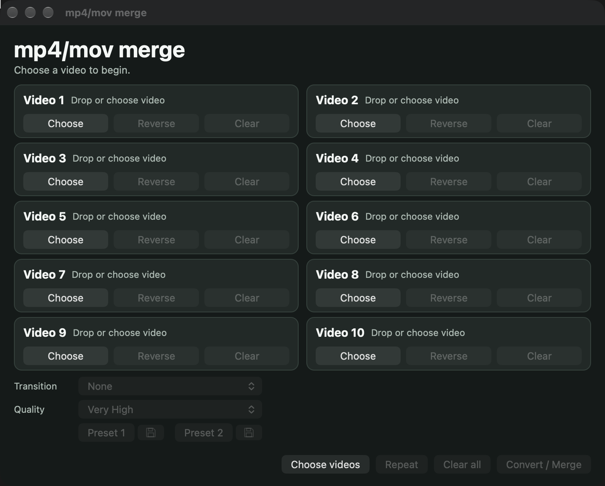

# mp4/mov merge



A small native macOS app that joins up to ten videos into one MP4. You can also convert a single video to MP4, reverse any clip, and add a transition between clips.

Videos are saved beside the first video you pick, with `_merged` or `_converted` added to the name.

## Features

- **Merge up to ten videos** in the order of the cards, by choosing files or dragging them onto a card.
- **Fast merging when possible.** Videos that match (same codec, size, orientation, frame rate, pixel format and audio) are joined by copying the streams, with no quality loss and no re-encoding.
- **Transitions** between clips (any FFmpeg `xfade` transition), with matching audio crossfades.
- **Quality presets** from Very High to Low, applied whenever video is re-encoded.
- **Reverse** any clip. The picture and sound play backwards in the output.
- **Repeat** copies the current selection into the empty cards, including each video's Reverse setting.
- **Presets** keep a Transition and Quality combination in Preset 1 or Preset 2.
- **Progress and cancel.** A progress bar shows the percentage and time left. Cancel stops the job and removes its temporary files.

## Requirements

- macOS 13 (Ventura) or later, on Apple silicon or Intel
- [FFmpeg](https://ffmpeg.org) with `ffmpeg` and `ffprobe`. Install with Homebrew:

  ```bash
  brew install ffmpeg
  ```

  The app looks for them in `PATH`, `/opt/homebrew/bin` and `/usr/local/bin`.

## Install

1. Download `mp4-mov-merge-1.0.dmg` from the [latest release](../../releases/latest).
2. Open the DMG and drag **mp4-mov merge** into **Applications**.
3. The app is not signed with an Apple developer certificate, so macOS blocks it the first time. Open **System Settings → Privacy & Security**, scroll to the message about "mp4-mov merge", and click **Open Anyway**. You only need to do this once.

## How to use

1. Choose videos with **Choose videos**, click a card's **Choose**, or drag files onto a card. Use **Clear** on a card, or **Clear all**, to remove them.
2. To reverse a clip, click its **Reverse** button. It turns dark red and reads **Reversed**. Click again to turn it off.
3. Pick a **Transition** (needs two or more videos) and a **Quality**.
4. Press **Convert / Merge**. Press **Cancel** (or Esc) to stop.

### Quality

Quality applies whenever video is re-encoded to H.264:

| Setting | CRF |
|---|---|
| Very High | 10 |
| High | 14 |
| Normal | 18 |
| Low | 23 |

Lower CRF means higher quality and a larger file.

### Re-encoding

A merge of matching videos with no transition is copied without re-encoding. If the videos differ, the app offers to re-encode and merge them. A single H.264, HEVC, AV1 or MPEG-4 video is copied into an MP4 without re-encoding, so Quality doesn't apply to it.

Reversed videos are always re-encoded at the selected Quality, so a merge that includes one never copies streams.

### Presets

Under Transition and Quality are **Preset 1** and **Preset 2**. Press a preset's disk button to save the current Transition and Quality into it, and press the preset to load them. Presets are kept when the app quits. A preset is grayed out until something is saved in it, and the presets and disk buttons are grayed out whenever both Transition and Quality are.

### Reverse

Reversed videos are played backwards with FFmpeg's `reverse` and `areverse` filters. FFmpeg holds a reversed clip in memory while it works, so progress may stay at 0% until the whole clip has been read. Use short clips for reversing. A single reversed video is saved as `<name>_reversed.mp4`.

Choosing or clearing a video turns its Reverse off. Repeat copies each card's Reverse setting.

### Phone videos and HEVC

Portrait phone videos are sized by their displayed orientation. Copied HEVC video is tagged `hvc1`, so QuickTime and Finder can play it.

When the videos in a copy merge count time in different units (common when joining a MOV and an MP4), the app first makes quick copies of the differing videos in the first video's time units, so playback doesn't stall where one video ends. These copies are not re-encoded.

## Temporary files

While it works, the app writes a temporary MP4 and, for a copy merge, a short concat list beside the first video. It also makes any time-unit copies described above. All of these are removed when the job finishes or is cancelled. The app doesn't create a log file.

## Building from source

The app is written in Swift and AppKit with no external packages.

```bash
./build.command
```

This needs the Xcode command line tools. It builds a universal app and places `mp4-mov merge.app` in this folder. If ad hoc signing fails, the app is still left in place, unsigned.

To make a DMG for a release:

```bash
./make-dmg.command
```

## Files

| File | Purpose |
|---|---|
| `main.swift` | Window, video cards, controls and presets |
| `MergeEngine.swift` | FFmpeg and FFprobe commands for copying, merging, transitions, reversing and quality |
| `IconGenerator.swift` | Draws the app icon during the build |
| `Info.plist` | App name, identifier and version |
| `build.command` | Builds the app |
| `make-dmg.command` | Packages the built app in a DMG |

## License

MIT License. See [LICENSE](LICENSE) for the full text.
